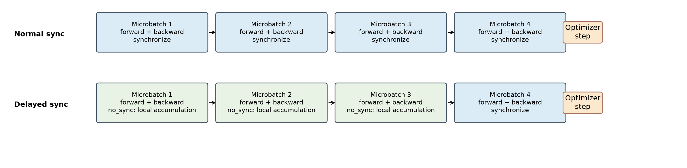
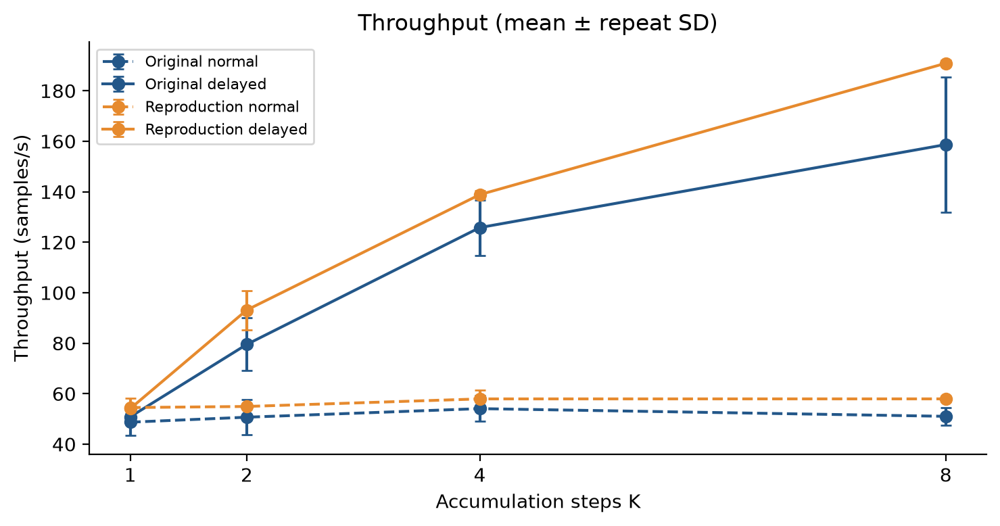

# 分布式数据并行与梯度同步开销

课程实验 D1 使用 PyTorch DDP，在单机 CPU/Gloo 上比较单进程与双进程训练，并研究梯度累积与延迟同步。模型为 GroupNorm ResNet-18，数据集为 CIFAR-10。

## 实验设计

DDP 在反向传播时同步各进程的梯度。设进程数为 P、每进程微批大小为 b、累积步数为 K，则有效全局批大小为 P × b × K；每个微批的损失除以 K。普通同步每个微批都同步梯度，延迟同步用 `no_sync()` 包围前 K−1 次前向和反向，在最后一次反向时同步。

| 配置 | 进程数 | 每进程微批 | K | 有效全局批 | 对照 |
|---|---:|---:|---:|---:|---|
| A1 | 1 | 128 | 1 | 128 | 单进程 |
| A2 | 2 | 64 | 1 | 128 | 双进程 DDP |
| B1 / C4 normal | 2 | 16 | 4 | 128 | 普通同步 |
| B2 / C4 delayed | 2 | 16 | 4 | 128 | 延迟同步 |
| C | 2 | 16 | 1、2、4、8 | 32、64、128、256 | 两种同步策略 |

原始实验和本人复现实验采用相同的 10 种配置；每配置预热 2 次、测量 4 次参数更新，重复 3 轮。两批共完成 60 次训练运行和 16 次独立 profiler 采样。

## 实验结果

| 配置 | 原始吞吐量（样本/秒） | 复现吞吐量（样本/秒） |
|---|---:|---:|
| A1 单进程 | 191.72 | 198.20 |
| A2 双进程 | 156.22 | 181.36 |
| B1 普通同步 | 54.08 | 57.93 |
| B2 延迟同步 | 125.80 | 138.85 |

两批中 A2 均低于 A1；K=4 时延迟同步分别达到普通同步吞吐量的约 2.33 倍和 2.40 倍。进程调度、梯度同步及资源竞争可能抵消 CPU 并行收益，但不能把耗时差直接视为通信时间。

采样检查显示 A1/A2 前三个 epoch 的完整批次样本集合一致；K=1、2、4、8 的数值验证通过，Rank 间参数最大误差为 0。本人重新运行的[终端记录](51290713112_高洁_D1/results/manual_20261125_223126/terminal_user.txt)和原始数据均已保存。

## 文件与复现

- [实验报告](51290713112_高洁_D1/report/51290713112_高洁_D1.docx)和[环境配置、运行说明](51290713112_高洁_D1/code/README.md)。
- `51290713112_高洁_D1/code/src/`：训练、采样检查、正确性验证、profiler 与统计分析。
- `51290713112_高洁_D1/results/final/`、`results/manual_20261125_223126/`：两批训练数据及日志；对应 `_profiler` 目录保存通信采样。
- [对比数据](51290713112_高洁_D1/results/comparison/comparison.csv)与 `figures/comparison/`：两批数据分析和图表。

在项目目录运行 `python code/scripts/compare_runs.py` 可以核对并分析已有数据，无需重新训练。完整的依赖、数据下载及实验命令见运行说明。

## 局限性

两批使用相同随机种子和短测量窗口，计划中的 20/200/3 长实验未执行，未实测 CPU 利用率和内存峰值。C 组的 K 与有效批大小同时变化；独立 profiler 使用合成输入，梯度桶重建影响事件数量，累计事件时间不能视为端到端通信耗时。结果不能直接推广到 GPU/NCCL 或长期训练。
