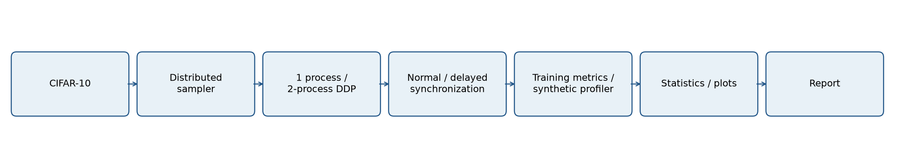
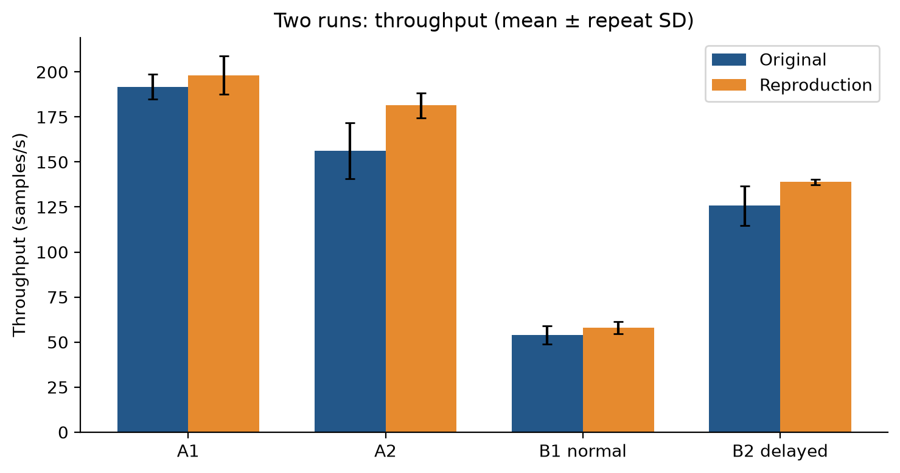
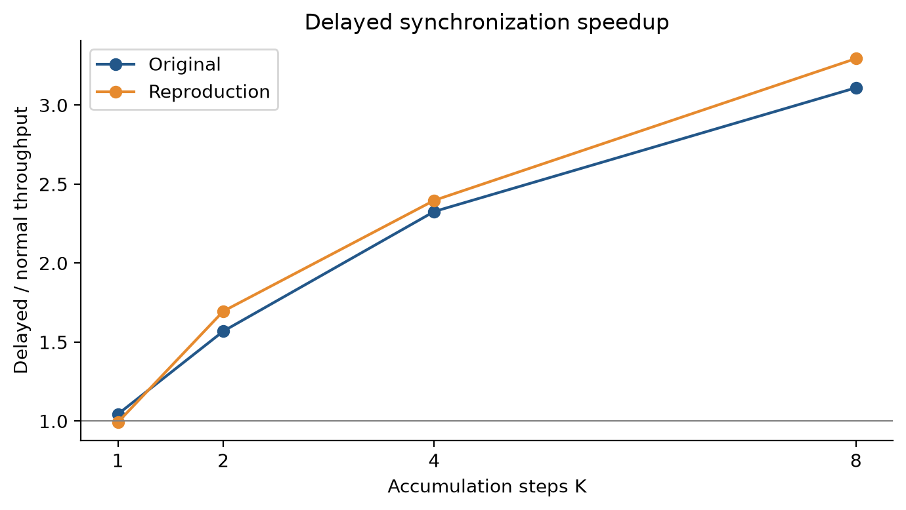
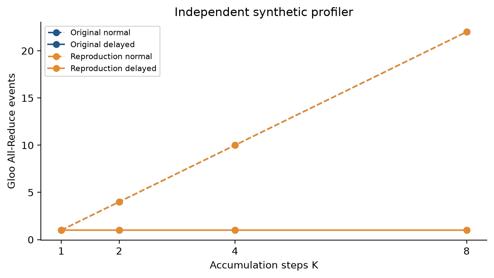
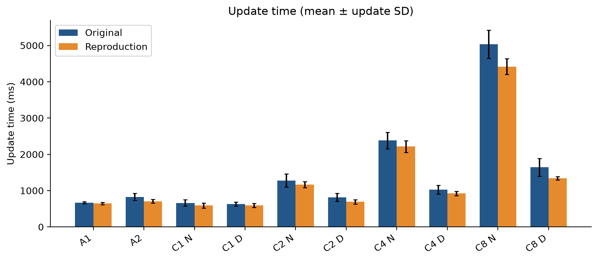
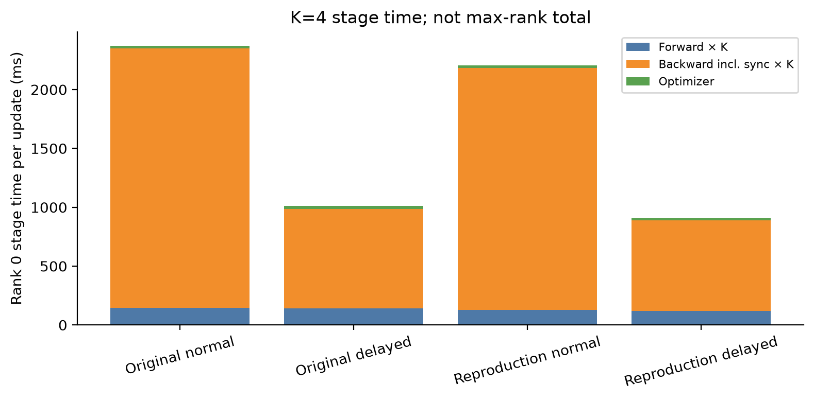

# 大规模数据处理系统：分布式数据并行实验

本项目使用 PyTorch DistributedDataParallel（DDP），比较单进程与双进程训练，并研究梯度累积与延迟同步对训练吞吐量和梯度通信的影响。实验在单机 CPU/Gloo 环境下开展。

## 实验设计

- **A 组**：比较单进程与双进程 DDP，均使用全局批大小 128。
- **B 组**：比较普通同步与 `no_sync()` 延迟同步，使用双进程、每进程微批大小 16、累积步数 K=4。
- **C 组**：比较 K=1、2、4、8 时两种同步策略的表现。

梯度累积时，每个微批的损失除以 K，累积 K 次后执行一次参数更新。有效全局批大小为 `进程数 × 每进程微批大小 × K`。

## 实验结果

在本机 CPU 上，每组预热 2 次、测量 4 次参数更新，重复 3 轮。以下为三轮平均吞吐量：

| 实验配置 | 吞吐量（样本/秒） |
|---|---:|
| A1：单进程 | 191.72 |
| A2：双进程 DDP | 156.22 |
| B1：K=4，普通同步 | 54.08 |
| B2：K=4，延迟同步 | 125.80 |

K=1、2、4、8 的数值正确性验证均通过。测量规模较小，结果主要反映本机短时负载下的相对表现；独立 profiler 的通信事件累计时间不能直接视为端到端通信开销。

## 目录与运行

- [项目目录](51290713112_%E9%AB%98%E6%B4%81_D1/)：项目源码、实验结果、图表和报告。
- [实验说明与复现步骤](51290713112_%E9%AB%98%E6%B4%81_D1/code/README.md)：环境配置、完整实验设计及运行命令。
- [实验结果](51290713112_%E9%AB%98%E6%B4%81_D1/results/final/)：逐步测量数据、配置、日志和汇总。
- [实验图表](51290713112_%E9%AB%98%E6%B4%81_D1/figures/final/)：吞吐量、更新耗时和通信事件图。
- [实验报告](51290713112_%E9%AB%98%E6%B4%81_D1/report/51290713112_%E9%AB%98%E6%B4%81_D1.docx)：课程实验报告。

项目使用 Python、PyTorch 和 torchvision；数据集为 CIFAR-10。环境配置及完整运行命令见[项目说明](51290713112_%E9%AB%98%E6%B4%81_D1/code/README.md)。

## 两批实验与复现

实验在 Windows、Python 3.11.18、PyTorch 2.15.0+cpu、torchvision 0.29.2+cpu 和 Gloo 下进行，使用 CIFAR-10、GroupNorm ResNet-18、SGD 和每进程一个 OpenMP 线程。两批是相同的 10 种配置，每批预热 2 次、测量 4 次并重复 3 轮，共 60 次训练和 16 次独立 profiler 采样。

DDP 保持每进程模型副本并按梯度桶同步。有效全局批大小为进程数 × 每进程微批大小 × K；每个微批损失除以 K。普通同步每个微批同步，延迟同步以 `no_sync()` 包围前 K−1 次前向和反向，在最后一次反向同步。

| 配置 | 原始吞吐量 | 复现吞吐量（样本/秒） |
|---|---:|---:|
| A1 单进程 | 191.72 | 198.20 |
| A2 双进程 | 156.22 | 181.36 |
| B1 K=4 普通同步 | 54.08 | 57.93 |
| B2 K=4 延迟同步 | 125.80 | 138.85 |

两批 A2 均低于 A1；K=4 延迟同步分别是普通同步的约 2.33 和 2.40 倍。进程调度、梯度通信和资源竞争可能影响收益；耗时差不能直接视为通信时间。K 变化同时改变有效批大小，不能将跨 K 变化全部归因于同步频率。

吞吐量误差棒是三轮标准差，更新耗时误差棒是逐更新标准差。阶段图将 Rank 0 的微批前向、反向均值乘 K；它不等于各 Rank 最大总耗时，且反向包含梯度同步。独立 profiler 使用合成输入，事件数受梯度桶重建影响；累计事件耗时不是端到端通信开销。

采样检查表明 A1/A2 前三个 epoch 的完整批次样本集合一致；K=1、2、4、8 的正确性验证通过，各 Rank 参数误差为 0。单进程参考参数最大误差为 1.1920929e-07。[本人复现终端记录](51290713112_高洁_D1/results/manual_20261125_223126/terminal_user.txt)保留了实际运行输出。

两批数据分别位于 `results/final/`、`results/manual_20261125_223126/`，对应 `_profiler` 目录包含通信采样；对比 CSV/JSON 位于 `results/comparison/`，图表位于 `figures/comparison/`。在项目目录运行 `python code/scripts/compare_runs.py` 可重新检查并生成对比，无需重新训练。

两批使用相同随机种子和短测量窗口；计划中的 20/200/3 长实验未执行，CPU 利用率和内存峰值未实测。CPU/Gloo 结果不能直接推广至 GPU/NCCL 或长期收敛。
